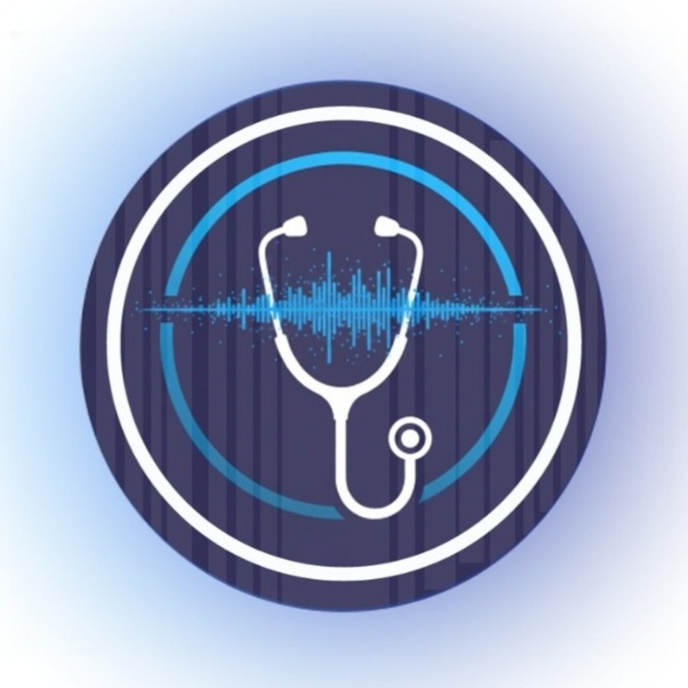

<p align="center"></p>

# Akıllı Steteskop

Makine öğrenmesi tabanlı akıllı steteskop: akciğer ve kalp seslerini analiz edip
kişinin sağlık durumu hakkında **ön bilgi** veren bir araç. Proje; sinyal işleme,
derin öğrenme ve gömülü sistemleri birleştiren bir öğrenci çalışmasıdır
(ayrıntı: [`docs/proje_ozeti.md`](docs/proje_ozeti.md), yol haritası: [`docs/GELISTIRME.md`](docs/GELISTIRME.md)).

> ⚠️ **Tıbbi teşhis aracı değildir.** Akciğer modelinin gerçek kayıtlardaki doğruluğu
> yaklaşık %60'tır. Sonuçlar yalnızca bilgilendirme ve araştırma amaçlıdır.

Araç, bir AI agent'ının (ör. **Claude Code**) çağırabileceği şekilde tasarlandı:

```
Kullanıcı ses dosyasını ses/ klasörüne koyar
   → Claude Code'a yolu söyler ("ses/hasta1.wav'ı analiz et")
   → Claude Code `steteskop analiz` komutunu çalıştırır
   → araç sesi eğitimle birebir aynı şekilde görüntüye çevirir ve modelleri çalıştırır
   → JSON rapor döner → Claude Code bunu sade Türkçe ile yorumlar
```

## Kurulum

Gereksinim: [uv](https://docs.astral.sh/uv/) (Python 3.10–3.12'yi kendisi kurar).

```bash
uv sync                       # sanal ortam + bağımlılıklar
uv run steteskop kontrol      # modeller ve kütüphaneler doğru yükleniyor mu?
```

`.m4a`/`.aac` dosyaları için ayrıca `ffmpeg` gerekir (`brew install ffmpeg`).
`.wav`, `.flac`, `.ogg`, `.mp3` ek bir şey gerektirmez.

## Kullanım

```bash
# Tek dosya
uv run steteskop analiz ses/hasta1.wav --tip akciger

# Bir klasördeki tüm ses dosyaları
uv run steteskop analiz ses/ --tip kalp

# Modele verilen spektrogram görüntülerini de kaydet, raporu dosyaya yaz
uv run steteskop analiz ses/hasta1.wav --tip akciger --goruntu-dizini raporlar/goruntu --cikti raporlar/hasta1.json
```

| Seçenek | Açıklama |
|---|---|
| `--tip akciger\|kalp` | Zorunlu. Kaydın türü (türü otomatik ayırt eden bir model yok). |
| `--goruntu-dizini` | Modele giren spektrogram PNG'lerini kaydeder. |
| `--cikti` | JSON raporu ayrıca dosyaya yazar. |
| `--bekcisiz` | Gürültü bekçisini atlar (bekçi gerçek bir kaydı yanlışlıkla eliyorsa). |
| `--girintisiz` | JSON'u tek satır yazar. |

Çıkış kodu: `0` her şey işlendi · `1` en az bir dosyada hata (ayrıntı `hatalar` alanında) · `2` ayar hatası.

### Örnek çıktı (kısaltılmış)

```json
{
  "arac": "akilli-steteskop", "surum": "0.1.0", "tip": "akciger",
  "tibbi_uyari": "Bu çıktı deneysel bir makine öğrenmesi modelinin tahminidir, ...",
  "raporlar": [{
    "dosya": "/.../ses/hasta1.wav", "durum": "tamam",
    "ses": { "sure_sn": 20.3, "ornekleme_hizi": 4000 },
    "kalite": { "toplam_parca": 4, "gecerli_parca": 3, "gurultu_parca": 1, "bekci_kullanildi": true,
                "uyarilar": ["1 parça gürültü olarak elendi ve sonuca katılmadı."] },
    "sonuc": { "sinif": "COPD", "sinif_tr": "KOAH", "ortalama_olasilik": 0.71, "guven_duzeyi": "orta",
               "ikinci_sinif": "Healthy", "ikinci_olasilik": 0.17, "fark": 0.54,
               "tutarlilik": 0.67, "oylar": { "COPD": 2, "Healthy": 1, "...": 0 }, "saglikli_mi": false },
    "olasiliklar": { "Asthma": 0.06, "Bronchial_Disease": 0.04, "COPD": 0.71, "Healthy": 0.17, "Pneumonia": 0.02 },
    "parcalar": [{ "no": 1, "bas_sn": 0, "bit_sn": 5, "gecerli": true,
                   "bekci": { "sinif": "Lung_Sound", "gecerli_olasiligi": 0.98 },
                   "tahmin": "COPD", "guven": 0.82, "olasiliklar": { "...": 0 } }],
    "model": { "ad": "akilli_steteskop_final_model", "bilinen_dogruluk": 0.6 }
  }],
  "hatalar": []
}
```

`guven_duzeyi`: `yuksek` (ort. olasılık ≥ 0.75), `orta`, `belirsiz` (< 0.50 ya da ilk iki sınıf farkı < 0.15).
`tutarlilik`: geçerli parçaların kaçta kaçının kazanan sınıfa oy verdiği.

## Claude Code ile kullanım

Repo kökünde Claude Code'u açın ve doğal dilde isteyin:

```
> ses/ klasörüne koyduğum akciğer kaydını analiz eder misin?
```

Analiz raporları ve spektrogram görüntüleri `raporlar/` klasörüne yazılır (git'e eklenmez).

Claude Code, [`.claude/skills/steteskop-analiz/SKILL.md`](.claude/skills/steteskop-analiz/SKILL.md)
içindeki talimatlara göre aracı çalıştırır ve sonucu yorumlar. Proje kuralları
[`CLAUDE.md`](CLAUDE.md) dosyasındadır.

## Mimari

```
steteskop/
  ayarlar.py   config.yaml'ı okur (model yolları, sınıf sıraları, ön işleme türü)
  ses.py       yükleme, kalite kontrolü, kalp bant geçiren filtresi, bölütleme
  ozellik.py   parça → spektrogram PNG → 128×128×3 tensör (eğitimle birebir aynı)
  modeller.py  Keras modellerini yükler, tahmin yapar
  analiz.py    bekçi → teşhis modeli → parça sonuçlarını birleştirme → rapor
  cli.py       `steteskop analiz` / `steteskop kontrol`, JSON çıktı
config.yaml    model kayıt defteri
modeller/      eğitilmiş .h5 modeller (Keras 3.12)
egitim/        veri hazırlama ve eğitim betikleri (bkz. egitim/README.md)
donanim/       ATmega328P boost converter kodu (bkz. donanim/README.md)
docs/          proje özeti, geliştirme günlüğü, görseller
ses/           analiz edilecek kayıtlar (git'e eklenmez)
tests/         birim ve entegrasyon testleri
.claude/       Claude Code skill'i (steteskop-analiz)
```

| Model | Girdi | Sınıflar |
|---|---|---|
| `akilli_steteskop_final_model.h5` (akciğer, CNN) | hibrit görüntü: STFT spektrogram + 13 MFCC, 5 sn ardışık parçalar | Asthma, Bronchial_Disease, COPD, Healthy, Pneumonia |
| `bekci_modeli.h5` (akciğer bekçisi, CNN) | hibrit görüntü | Lung_Sound, Noise |
| `kalp_modeli.h5` (kalp, CNN + BiLSTM) | 20–1000 Hz filtre + yalnız spektrogram (magma), 5 sn pencere / 2.5 sn kaydırma | Hasta, Normal |

## Bilinen sınırlamalar

- **Veri sızıntısı:** Eğitimde aynı hastanın parçaları ve çoğaltılmış kopyaları hem eğitim hem
  doğrulama setine düştü; eğitim grafiğindeki ~%97 gerçekçi değil, gerçek doğruluk ~%60.
  Hasta bazlı bölme ile yeniden eğitim gerekiyor.
- **Kalp bekçisi yok:** `bekci_kalp_modeli.h5` repoda bulunmadığı için kalp kayıtlarında gürültü ayıklanamıyor.
- **Tür ayrımı yok:** Kaydın akciğer mi kalp mi olduğunu kullanıcı belirtmeli.
- **Örnekleme hızı:** Modeller veri setlerinin kendi örnekleme hızlarıyla eğitildi; farklı bir
  cihazla alınan kayıtlarda spektrum ölçeği kayabilir.
- **Bekçi sınıf sırası** (`Lung_Sound`, `Noise`) eğitim betiğindeki yoruma dayanır; model yeniden
  eğitilirse `config.yaml` güncellenmelidir.

## Testler

```bash
uv run pytest            # hızlı birim testleri + modelli entegrasyon testleri
uv run pytest -m "not model"   # yalnız hızlı testler
```
